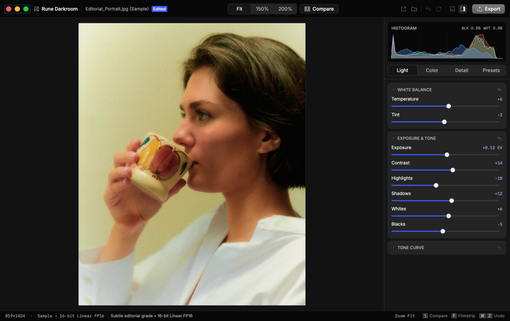
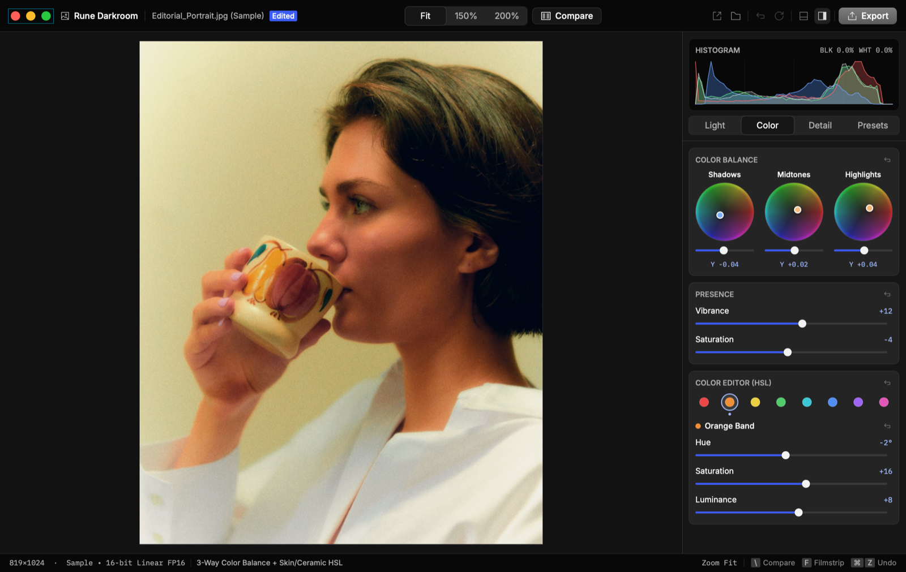
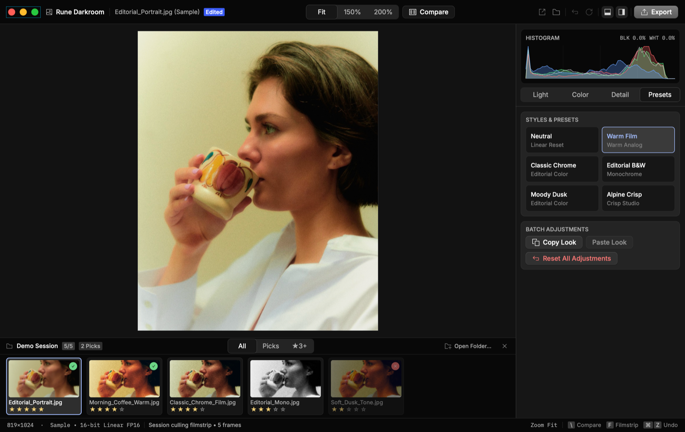

# Rune Darkroom

[](https://github.com/sambitcreate/rune-editor/actions/workflows/ci.yml)
[](LICENSE)
[](CONTRIBUTING.md)

**A Mac-first, cross-platform-ready, GPU-accelerated RAW photo editor built in Rust on [Anomaly's Rune](https://github.com/anomalyco/rune).**

Inspired by **Capture One** and **Lightroom**, Rune Darkroom runs a single-pass scene-referred linear `Rgba16Float` WGSL develop pipeline directly on Rune's native `objc2-metal` backend (with portable `wgpu` for DX12/Vulkan) inside an Anomaly OpenCode-styled, Apple macOS HIG-compliant darkroom interface.

<p align="center">
  
</p>
<p align="center">
  
  
</p>

---

## Features

- **Blazing-Fast Single-Pass Linear GPU Develop (`Rgba16Float`)**
  - Scene-referred linear light pipeline (`shaders/develop.wgsl`) running directly on macOS Metal via Rune's `Compositor` + `El::effect`.
  - White Balance (Temperature & Tint), Exposure (`2^EV`), Contrast (18% middle-gray pivot), Highlights, Shadows, Whites, Blacks, Vibrance, Saturation, Optical Vignette, Film Grain, and soft filmic highlight roll-off.
  - Gated spatial **Clarity**, **Unsharp Mask Sharpening**, and edge-aware **Noise Reduction** with zero overhead when inactive.
- **Capture One-Style Pro Color Tools**
  - Interactive **3-Way Color Balance Wheels** (Shadows / Midtones / Highlights hue-chroma wheels + luma trim sliders).
  - Interactive **Fritsch-Carlson Monotonic Tone Curves** (Luma, Red, Green, Blue) baked to a `256×1` `Rgba16Float` GPU LUT texture.
  - **8-Band Color Editor (HSL)** across Red, Orange, Yellow, Green, Aqua, Blue, Purple, and Magenta with smooth angular blending.
  - Live anti-aliased **RGB + Luminance Histogram** with shadow/highlight clip telemetry.
- **Real Camera RAW Decoding & Full-Res Export**
  - **macOS Tier 1:** Hardware-accelerated Apple **`CIRAWFilter` / `CoreImage`** + **`ImageIO`** (`< 3 ms` embedded EXIF thumbnails, ProRAW, DNG, CR2/CR3, NEF, ARW, RAF, ORF, RW2, PEF, SRW, HEIC/HEIF).
  - **Cross-Platform Tier 2:** Pure-Rust **`rawler`** linear RAW + bilinear Bayer demosaic fallback, plus JPEG, PNG, TIFF, and WebP.
  - **`rayon`-parallel Full-Res Export** to 8-bit JPEG/PNG and 16-bit PNG/TIFF with verified GPU-to-CPU color-science parity.
- **Folder Session Culling & Non-Destructive Sidecars**
  - Open any folder directly (`⌘⇧O`) with zero import ceremony, collapsible Filmstrip (`F`), star ratings (`1`–`5`), Pick (`P`) / Reject (`X`) flags, `All | Picks | ★3+` filters, background neighbor prefetching on `←`/`→`, Copy/Paste Look (`⌘⇧C`/`⌘⇧V`), and `.rune-edit.json` sidecar persistence (`⌘S`).
- **Native macOS Craft + Anomaly OpenCode Design Language**
  - Styled with `rune-theme-opencode` (`#080808` / `#121212` / `#161616` / `#242424` neutral darkroom ladder + Inter & IBM Plex Mono `'tnum' 1`), unified macOS `Titlebar` with `ChromeInsets` traffic-light clearance, native `NSMenu` menu bar, 120Hz ProMotion trackpad pinch-to-zoom / two-finger rotate / drag pan, and Before/After split compare (`\`).

---

## Quick Start

### Prerequisites
- **macOS** (Apple Silicon recommended; Xcode Command Line Tools installed)
- **Rust** toolchain supporting **Edition 2024** (`rustc 1.85+`; tested on `1.100`)

### Build & Run
```bash
git clone https://github.com/sambitcreate/rune-editor.git
cd rune-editor
cargo run -p rune-editor --release
```

> The app launches with a bundled sample photograph ([`assets/samples/editorial_portrait.jpg`](assets/samples/editorial_portrait.jpg)) so you can test every color wheel, tone curve, and filmstrip control immediately. Drag & drop any RAW/JPEG/PNG/TIFF/HEIC photo onto the canvas or press `⌘O` / `⌘⇧O` to open your own photos!

### Run Tests & Headless Visual Verification
```bash
cargo test --workspace
cargo clippy --workspace --all-targets -- -D warnings

# Render a full-window GPU snapshot headlessly (no window required)
cargo run -p rune-editor --release -- --chrome --snap preview.png --scene editorial
```
Available headless scenes: `editorial`, `color`, `tone-curve`, `split`, `filmstrip`.

---

## Keyboard Shortcuts

| Shortcut | Action |
| :--- | :--- |
| `⌘O` / `⌘⇧O` | Open Photo / Open Folder |
| `⌘⇧E` | Export Full-Resolution Image (JPEG / PNG-16 / TIFF-16) |
| `⌘S` | Save `.rune-edit.json` Sidecar |
| `⌘Z` / `⌘⇧Z` | Undo / Redo |
| `⌘⇧C` / `⌘⇧V` | Copy Look / Paste Look |
| `⌘R` | Reset All Adjustments |
| `\` | Toggle Before / After Split Compare |
| `⌘0` / `⌘1` / `⌘2` | Zoom Fit / 150% / 200% (or trackpad pinch & two-finger double-tap) |
| `F` / `I` | Toggle Filmstrip / Toggle Right Inspector |
| `←` / `→` | Previous / Next Photo in Session |
| `1`–`5`, `0` | Set Star Rating (0 clears) |
| `P` / `X` | Toggle Pick / Reject Flag |

---

## Architecture

```text
rune-editor/
├── crates/
│   ├── core/      # UI/GPU-agnostic DevelopRecipe, Fritsch-Carlson ToneCurves, 3-Way Color Balance,
│   │              # 8-Band HSL, SessionCatalog, sidecar serialization, and CPU reference color math
│   ├── decode/    # macOS CIRAWFilter/ImageIO + portable rawler RAW decode, fast thumbnails, rayon export
│   ├── engine/    # Portable wgpu Compositor backend, Rgba16Float image & 256x1 curve LUT textures
│   └── app/       # Anomaly OpenCode-styled Rune UI, macOS Titlebar/NSMenu, interactive pro widgets
└── shaders/
    └── develop.wgsl  # Single-pass linear Rgba16Float WGSL develop pipeline
```

---

## Roadmap

- [x] **Phase 0 & 1:** Rune `Compositor` + `El::effect` 120Hz viewport, linear `Rgba16Float` WGSL develop pipeline, native RAW decoding (`CIRAWFilter` + `rawler`), full-res export, sidecar persistence.
- [x] **Phase 2:** Capture One-style 3-Way Color Balance wheels, Fritsch-Carlson RGB/Luma Tone Curves LUT, 8-Band HSL, Clarity/Sharpening/Denoise, Folder Filmstrip culling, Anomaly OpenCode UI + Apple macOS HIG polish.
- [ ] **Phase 3:** Local Adjustment Layers & Masks (Linear/Radial gradients, sparse `256×256` CoW Brush, Apple Neural Engine Subject/Sky masking via `objc2-vision`).
- [ ] **Phase 4:** Wide-gamut **Display P3** & **XDR/EDR HDR** swapchain output, ISO 21496-1 Adaptive Gain Map export, GPU WGSL AHD/RCD demosaic, and Windows/Linux CI & packaging.

---

## Contributing

**Pull requests are warmly welcomed!** Whether you're adding a color tool, improving RAW camera support, porting to Windows/Linux, or polishing accessibility and performance, see [CONTRIBUTING.md](CONTRIBUTING.md) to get started.

## License

Licensed under the [MIT License](LICENSE). Built with [Rune](https://github.com/anomalyco/rune) (MIT, © Anomaly).
